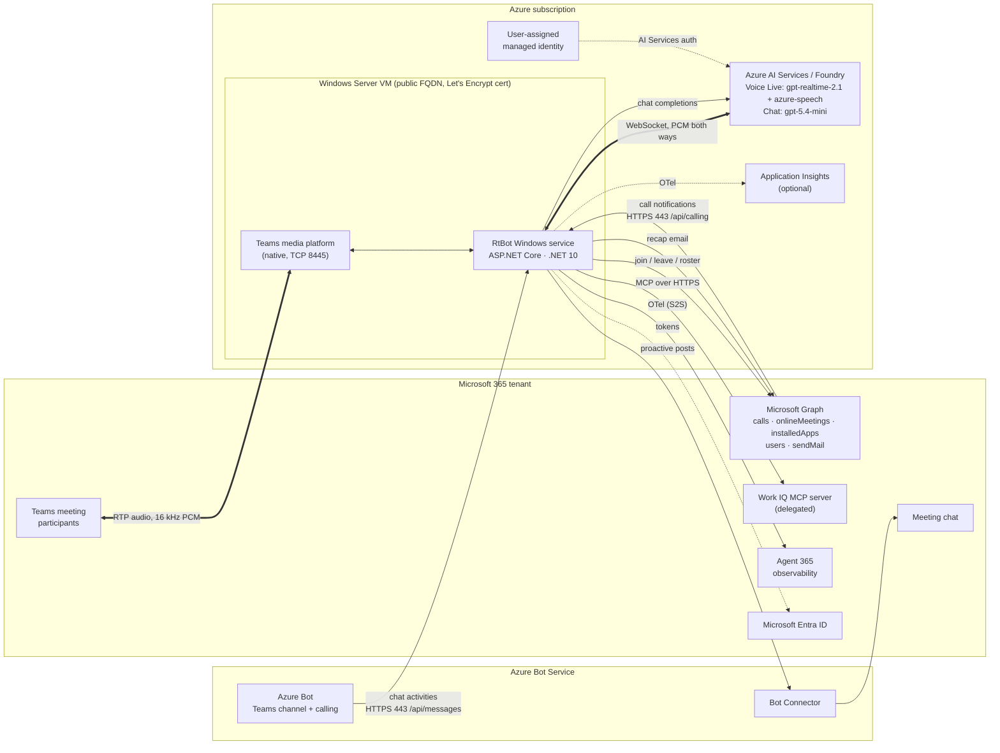
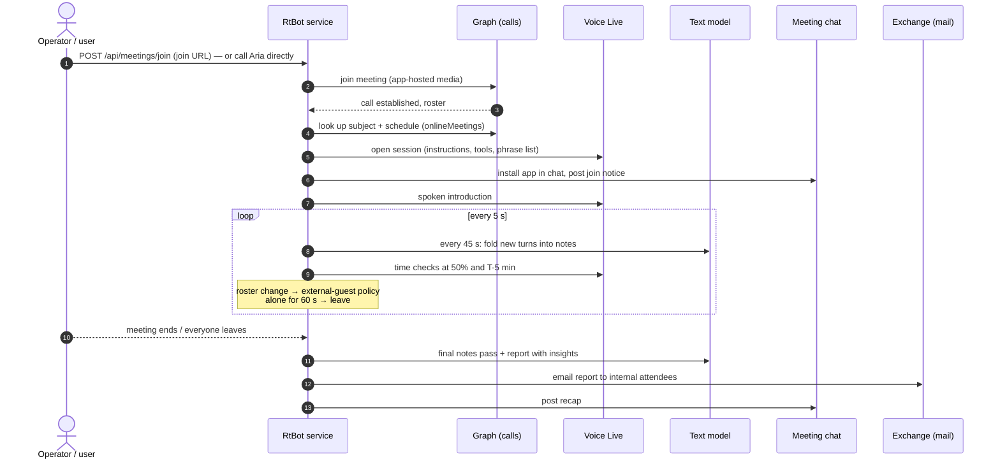
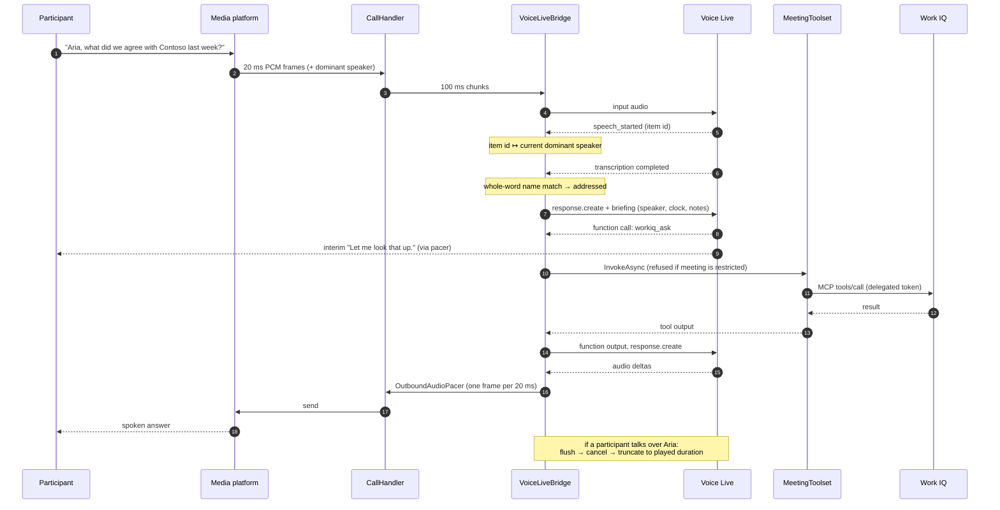

# Aria: a realtime voice facilitator for Microsoft Teams meetings

[](LICENSE)

> **Independent open-source project.** This is not a Microsoft product. It is not affiliated with, endorsed by, sponsored by or supported by Microsoft Corporation. See the [Disclaimer](#disclaimer).

Aria joins a Teams meeting as a participant, listens to the whole conversation, and answers **out loud** when someone says her name. While the meeting runs she keeps notes, decisions and action items. She can look up Microsoft 365 work data through **Work IQ**, answer @mentions in the meeting chat, and give time checks. When the meeting ends she posts a recap to the chat and **emails attendees a summary, insights and an actions table**. Activity is exported as OpenTelemetry to **Microsoft Agent 365**.

> Status: working proof of concept. It runs end to end against a real tenant. See [Limitations](#limitations) before relying on it.

---

## Contents

- [What it does](#what-it-does)
- [How it compares](#how-it-compares)
- [Architecture](#architecture)
  - [Topology](#topology)
  - [Meeting lifecycle](#meeting-lifecycle)
  - [A spoken turn, end to end](#a-spoken-turn-end-to-end)
  - [Components](#components)
  - [Design decisions](#design-decisions)
- [Dependencies](#dependencies)
- [Identity and permissions](#identity-and-permissions)
- [Security model](#security-model)
- [Observability and audit](#observability-and-audit)
- [Deployment](#deployment)
- [Configuration reference](#configuration-reference)
- [Operating it](#operating-it)
- [Repository layout](#repository-layout)
- [Limitations](#limitations)
- [Contributing and security](#contributing-and-security)
- [Licence](#licence)
- [Disclaimer](#disclaimer)

---

## What it does

| Capability | How |
| --- | --- |
| **Speaks in the meeting** | Realtime speech-to-speech through Azure AI Voice Live (`gpt-realtime-2.1`), with server echo cancellation and noise suppression. Teams audio is 16 kHz PCM end to end, so nothing is resampled. |
| **Answers only when addressed** | Continuous transcription. A reply starts only when the agent's name is said as a whole word. The same speaker can ask a follow-up within 10 s without repeating the name. |
| **Knows who is talking** | Each utterance is attributed to the Teams dominant speaker. Attendee names feed the recogniser's phrase list. |
| **Meeting memory** | A text model folds the conversation into running notes every 45 s: summary, decisions, action items and open questions. Every reply carries a fresh briefing with who is speaking, time elapsed and remaining, and the notes. |
| **Facilitator tools** | `record_action_item`, `record_decision`, `get_meeting_status`, `set_timer`, `post_to_meeting_chat`, `post_recap_now`, `leave_meeting`, plus every Work IQ MCP tool. |
| **Work IQ** | Mail, calendar, files, chats and people lookups through the Work IQ MCP server, run as a delegated service account. |
| **Meeting chat** | Posts a join notice and the recap through Bot Framework proactive messaging. Answers @mentions with the same tools and notes as the voice path. |
| **Time-keeping** | Speaks a time check at halfway and a few minutes before the scheduled end, read from the meeting's schedule in Graph. |
| **External-guest policy** | When a guest, phone dial-in, anonymous user or other-tenant user joins, Aria announces it and **withdraws organisation-data tools**. The alternative policy setting makes her leave. |
| **End-of-meeting report** | Posts a recap to the chat and emails internal attendees a summary, key insights, decisions, actions (owner and due date), open questions, next steps and share of speaking time. |
| **Self-management** | Leaves when alone for 60 s, rebuilds the voice session if it drops (re-seeding it with the notes), and leaves if it cannot recover. |

## How it compares

As of November 2026:

| | Speaks in the meeting | Customisable | Org data | Teams |
| --- | --- | --- | --- | --- |
| **Aria (this repo)** | **Yes, by name, realtime** | Fully (code) | Work IQ (delegated) | Yes |
| Microsoft Facilitator | No (chat @mention) | No | Microsoft 365 Copilot | Yes, internal meetings only |
| Claude in meetings (announced) | No (chat) | Limited | Connectors | No (Google Meet first) |
| Zoom AI Companion live agent | Announced | Limited | Zoom | No |

---

## Architecture

### Topology



**Network surface on the VM**

| Port | Direction | Purpose |
| --- | --- | --- |
| 443/TCP | Inbound | HTTPS signalling: Graph call notifications, Bot Framework chat activities, operator API. Every route requires a token. |
| 8445/TCP | Inbound | Teams real-time media (native media platform, mutual TLS). |
| 80/TCP | Inbound | Let's Encrypt HTTP-01 challenge only (win-acme renewals). |
| 3389/TCP | Inbound | RDP, restricted to `allowedManagementCidrs` (empty by default). |

### Meeting lifecycle



### A spoken turn, end to end



### Components

| Path | Responsibility |
| --- | --- |
| `src/RtBot/Program.cs` | Host, DI, Kestrel HTTPS (certificate resolved by FQDN so renewals don't break start-up), JWT schemes (Entra operator, Bot Framework), OpenTelemetry with Agent 365. |
| `Teams/TeamsCallingService.cs` | Graph Communications client, media session, join and answer calls, one `CallHandler` per call. |
| `Teams/CallHandler.cs` | One live call. Audio pump, dominant-speaker attribution, roster and external-guest policy, facilitator loop (scribe, time checks, leave when alone), wrap-up (recap and email). Implements `IMeetingActions`. |
| `Teams/MeetingDetailsLookup.cs` | Meeting subject and schedule from Graph `onlineMeetings`. |
| `Voice/VoiceLiveBridge.cs` | The Voice Live session. Configuration, reconnect with notes re-seeding, name and follow-up gating, per-response briefing, barge-in truncation, tool dispatch. |
| `Media/OutboundAudioPacer.cs` | Owns the playback clock: one 640-byte frame every 20 ms, three frames of lookahead, click-free flush, true played duration for truncation. |
| `Facilitator/MeetingContext.cs` | The meeting's durable state: transcript turns, participants and attendees, talk time, notes, briefing renderer. |
| `Facilitator/MeetingScribe.cs` | Rolling notes every 45 s, and the final report with insights. |
| `Facilitator/MeetingToolset.cs` | Local facilitator tools plus the MCP catalogue, with restricted-mode filtering **and** enforcement at dispatch. |
| `Facilitator/MeetingMailer.cs` | Resolves internal attendees and sends the HTML report through Graph `sendMail`. All content is HTML-encoded. |
| `Facilitator/TextModelClient.cs` | Minimal Azure OpenAI v1 chat-completions client (JSON mode, tool loop, vision) on the managed identity. |
| `Chat/BotChatClient.cs` | Bot Connector proactive messages and replies. Installs the Teams app into the meeting chat with resource-specific consent. Allow-lists Bot Connector hosts. |
| `Controllers/MessagesController.cs` | `POST /api/messages`: chat @mentions answered by the text model with the meeting's tools. |
| `Controllers/MeetingsController.cs` | Operator API: join, leave, say, list. |
| `Controllers/PlatformCallController.cs` | Graph calling webhook. The SDK validates Graph's token on every notification. |
| `Tools/ToolCatalog.cs` | MCP client connections (Work IQ and any extras) and tool-call spans. |
| `Tools/DelegatedTokenProvider.cs` | Redeems the service account's refresh token for Work IQ and Graph scopes and persists rotations. |
| `Observability/AgentTelemetry.cs` | Agent 365 / OpenTelemetry span helpers. |

### Design decisions

The full decision record is in [docs/ARCHITECTURE.md](docs/ARCHITECTURE.md). In short:

1. **An application-hosted media bot, not a meeting extension.** It is the only Teams path that gives a bot raw, real-time call audio both ways. Microsoft supports it but discourages it for AI agents, and it requires a Windows VM.
2. **Voice Live, not the raw Realtime API.** Native 16 kHz PCM matches Teams, it has server-side echo cancellation (the agent hears itself in the meeting mix), noise suppression, semantic VAD, interim responses, and managed-identity auth.
3. **Gated responses.** `CreateResponse = false` on the VAD. An always-on responder talks over everyone in a group call.
4. **Per-response briefing, not a growing prompt.** `StartResponseAsync(additionalInstructions)` attaches the current state to each reply without adding it to the model's context window.
5. **Two models.** The realtime model is for conversation. A cheaper text model (`gpt-5.4-mini`) handles notes, the report and chat answers, where structured JSON output and long context matter more than latency.
6. **Local MCP dispatch.** Tool calls run in this process, so restricted-mode enforcement, telemetry and per-call auth stay in the agent's control.
7. **Bot Framework for chat.** App-only Graph `POST /chats/{id}/messages` is reserved for migration and returns Forbidden. Proactive Bot Connector messages are the supported path.

---

## Dependencies

### Runtime and NuGet

| Package | Version | Why |
| --- | --- | --- |
| .NET / ASP.NET Core | 10.0 (LTS) | Host. Target `net10.0-windows`, x64 only. |
| `Microsoft.Graph.Communications.Calls.Media` | 1.2.0.18742 | Teams calling and real-time media. **Must be kept current**: versions older than about 3 months stop working against the service. |
| `Microsoft.Skype.Bots.Media` | 1.33.0.258-preview | Native media platform (direct reference required for native assets). |
| `Azure.AI.VoiceLive` | 1.2.1 | Realtime voice session. |
| `Azure.Core` | 1.65.0 | Credentials (includes the former Azure.Identity types). |
| `ModelContextProtocol.Core` | 2.4.0 | MCP client for Work IQ. |
| `Microsoft.Identity.Client` | 4.92.0 | App-only tokens (Graph, Bot Connector, Agent 365). |
| `Microsoft.OpenTelemetry` | 1.2.0 | OpenTelemetry distro with the Agent 365 exporter. |
| `Microsoft.AspNetCore.Authentication.JwtBearer` | 10.0.0 | Operator API and Bot Framework token validation. |
| `Microsoft.Extensions.Hosting.WindowsServices` | 10.0.0 | Runs as a Windows service. |
| `System.Security.Cryptography.ProtectedData` | 10.0.0 | DPAPI-encrypted secrets at rest. |
| `Azure.Security.KeyVault.Secrets` | 4.8.0 | Optional token store when a private-endpoint Key Vault is available. |

### Azure

| Service | Notes |
| --- | --- |
| Windows Server VM | `Standard_D4s_v5` or larger. Public IP with DNS label, inbound 443 and 8445. Visual C++ runtime, .NET 10 SDK and ASP.NET Core runtime. |
| Azure AI Services (Foundry) | Voice Live in a region with realtime models (built in Sweden Central). `gpt-realtime-2.1` is service-managed in Voice Live. Deploy a chat model for the scribe (default deployment name `gpt-5.4-mini`). |
| Azure Bot | Teams channel with **calling enabled**. Calling webhook `https://<fqdn>/api/calling`, messaging endpoint `https://<fqdn>/api/messages`. Single-tenant. |
| User-assigned managed identity | `Cognitive Services User` on the AI Services resource. |
| Log Analytics and Application Insights | Optional second telemetry sink. |
| Key Vault | Optional. Used only when reachable over a private endpoint. Otherwise secrets are DPAPI-encrypted on the VM. |

### Microsoft 365

| Item | Notes |
| --- | --- |
| Teams app | Built from [`teams-app/manifest.json`](teams-app/manifest.json) (replace `{{BOT_APP_ID}}` and `{{BOT_HOST}}`), uploaded to the org catalogue. |
| Resource account (optional) | Teams resource account with a `PHONESYSTEM_VIRTUALUSER` licence, so users can call or add the agent from Teams. |
| Work IQ service account | A licensed user the agent acts as for Work IQ and for sending the recap email. |
| Work IQ | Generally available. Delegated only. Write actions are blocked unless an admin enables them. |
| Agent 365 | For observability export. |
| Teams application access policy | Lets the bot read `onlineMeetings` (subject and schedule) app-only. |

---

## Identity and permissions

**Bot app registration (application permissions, admin-consented)**

| Permission | Used for |
| --- | --- |
| `Calls.JoinGroupCall.All`, `Calls.JoinGroupCallAsGuest.All`, `Calls.AccessMedia.All` | Join meetings and access call audio. |
| `OnlineMeetings.Read.All` | Meeting subject and schedule (also needs the Teams application access policy). |
| `TeamsAppInstallation.ReadWriteAndConsentSelfForChat.All` | Install itself into a meeting chat, granting its RSC permissions, so it can post and be @mentioned. |
| `Agent365.Observability.OtelWrite` | Export telemetry to Agent 365 (service-to-service). |

**Delegated grants for the service account only** (consent type `Principal`, not tenant-wide)

| Scope | Used for |
| --- | --- |
| `WorkIQAgent.Ask` | Work IQ MCP. |
| `Mail.Send` | Recap email, sent from the service account. |
| `User.ReadBasic.All` | Resolve attendees to email addresses. |

**Teams app RSC permissions:** `Calls.JoinGroupCalls.Chat`, `Calls.AccessMedia.Chat`, `OnlineMeetingParticipant.Read.Chat`, `ChatMessage.Read.Chat`, `ChatMessage.Send.Chat`.

**Operator API:** the app exposes app role `RtBot.Operate` and delegated scope `Meetings.Join`. Pre-authorise the Azure CLI client so operators can call it with `az login`.

---

## Security model

| Concern | Control |
| --- | --- |
| Public endpoints | Every route needs a token. `/api/calling` is validated by the Graph Communications SDK, `/api/messages` by a Bot Framework JWT scheme (issuer `https://api.botframework.com`, audience = app id, keys from Bot Framework OpenID metadata), and the operator API by Entra JWT plus the `RtBot.Operate` role or `Meetings.Join` scope. Only `/api/health` is anonymous. |
| Token exfiltration via `serviceUrl` | Chat replies go only to `*.botframework.com` and `*.trafficmanager.net` hosts. |
| Secrets at rest | No secrets in the repo or in configuration files. The client secret and the Work IQ refresh token are DPAPI-encrypted with the **machine** key on the VM (unreadable if copied off it). AI Services uses the managed identity. |
| External participants | When anyone not provably internal is present, organisation-data tools are removed from the model's tool list **and** refused at dispatch, for both voice and chat. The model's instructions are not the security boundary. Policy options are `Restrict` (default), `Leave` or `Allow`. |
| Email distribution | The report goes only to attendees in the agent's own tenant, plus the organiser. External attendees are never emailed. Every value is HTML-encoded. |
| Prompt injection | Organisation-data tools act as the service account, so they can never see more than it can. Work IQ write actions stay disabled unless an admin enables them. Use a dedicated, least-privilege service account in production. |
| Disclosure | Aria announces herself by voice and in chat on joining, says she is taking notes, and accepts requests to leave. |
| Least privilege on mail | `Mail.Send` and `User.ReadBasic.All` are granted to the service account only. |
| Certificates | Let's Encrypt via win-acme with automatic renewal. The service picks up the current certificate for the FQDN at start-up. |

> **Media Access API terms.** Graph's `updateRecordingStatus` is only allowed for compliance-recording bots, so this agent does not set the recording indicator. Its spoken and written join notice is the disclosure, and the recap is produced only after that notice has been given. Review this against your own compliance requirements before production use.

---

## Observability and audit

| Signal | Where |
| --- | --- |
| Meeting span (one per call) | Agent 365 (and Application Insights if configured). |
| Tool-call spans (Work IQ and other MCP tools) | Agent 365. |
| Work IQ requests | Microsoft Purview audit, as the service account. |
| Recap emails | Service account's Sent Items and the Exchange audit log. |
| Graph and token activity | Entra sign-in logs for the bot's service principal. |
| Service log | Windows Application event log (warnings and errors). |

**Not yet emitted:** per-turn inference spans for voice replies, chat answers and scribe/report calls, and spans for local tools and email. The agent reports under its app registration id rather than an Entra Agent ID, so it appears in Agent 365 as telemetry but not as a registry-managed agent.

---

## Deployment

### 1. Azure infrastructure

```powershell
az deployment group create -g <rg> -f infra/main.bicep `
  -p dnsLabel=<label> adminUsername=<user> adminPassword=<password> operatorObjectId=<your-object-id>
```

The template creates the VM, NSG, public IP, managed identity, AI Services, Log Analytics, Application Insights and Key Vault, and assigns the roles. It deploys a realtime model and a transcription model. The current code uses the service-managed `gpt-realtime-2.1` in Voice Live, so those two deployments are optional. **Add a chat model deployment** for the scribe (for example `gpt-5.4-mini`).

### 2. Entra and Bot

1. Register a single-tenant app. Add the application permissions above and grant admin consent.
2. Expose the `RtBot.Operate` app role and `Meetings.Join` scope, and pre-authorise the Azure CLI.
3. Create an **Azure Bot** with that app id. Enable the Teams channel with **calling**. Set the calling webhook to `https://<fqdn>/api/calling` and the messaging endpoint to `https://<fqdn>/api/messages`.
4. Grant `Agent365.Observability.OtelWrite` to the app for Agent 365 export.

### 3. Teams

```powershell
# Teams application access policy so the bot can read online meeting details
New-CsApplicationAccessPolicy -Identity RtBot-Meetings -AppIds <bot-app-id>
Grant-CsApplicationAccessPolicy -PolicyName RtBot-Meetings -Global
```

Fill in `teams-app/manifest.json`, zip it with the two icons, and upload it to the org app catalogue. Optionally create a resource account and associate it with the bot so people can call the agent directly.

### 4. Media host

Run [`scripts/Initialize-MediaHost.ps1`](scripts/Initialize-MediaHost.ps1) on the VM. It installs the runtime prerequisites and gets a Let's Encrypt certificate for the FQDN. Then install the service from [`scripts/install-service.template.ps1`](scripts/install-service.template.ps1). Configuration is machine environment variables of the form `RtBot__Section__Key`.

### 5. Work IQ and mail service account

```powershell
Copy-Item scripts/deployment.example.ps1 scripts/deployment.local.ps1   # git-ignored; fill in
./scripts/Reconnect-WorkIq.ps1   # device-code sign-in; token stored encrypted on the VM
```

Grant the delegated scopes (`WorkIQAgent.Ask`, `Mail.Send`, `User.ReadBasic.All`) to the service account.

### 6. Build and deploy

```powershell
./scripts/Publish-ToHost.ps1   # pushes source, builds on the VM, restarts the service
```

---

## Configuration reference

All settings are under `RtBot` in [`appsettings.json`](src/RtBot/appsettings.json), overridable with environment variables such as `RtBot__Voice__Model`.

| Key | Default | Meaning |
| --- | --- | --- |
| `AzureAd:TenantId`, `AzureAd:AppId` | | Bot registration. |
| `AzureAd:AppSecretFile` | `C:\rtbot\state\client.secret` | DPAPI-protected client secret. |
| `Media:ServiceFqdn` | | Public FQDN. Must match the certificate. |
| `Media:CertificateThumbprint` | | Optional. Falls back to the newest valid certificate for the FQDN. |
| `Voice:Endpoint` | | AI Services endpoint. |
| `Voice:Model` | `gpt-realtime-2.1` | Voice Live model. |
| `Voice:TranscriptionModel` | `azure-speech` | Supports a phrase list, which matters for name recognition. |
| `Voice:VoiceName` | `en-GB-SoniaNeural` | Azure neural voice. |
| `Voice:AgentName` / `NameAliases` | `Aria` | Name the agent answers to, plus recogniser misspellings. |
| `Voice:FollowUpWindowSeconds` | `10` | Follow-ups without the name. |
| `Tools:WorkIqMcpUrl` | Work IQ endpoint | MCP server. |
| `Tools:TeamsAppCatalogId` | | Catalogue id installed into each meeting chat. |
| `Facilitator:ExternalParticipants` | `Restrict` | `Allow`, `Restrict` or `Leave`. |
| `Facilitator:ScribeModel` | `gpt-5.4-mini` | Chat deployment for notes, report and chat answers. |
| `Facilitator:ScribeIntervalSeconds` | `45` | Notes cadence. |
| `Facilitator:WrapUpWarningMinutes` | `5` | End-of-meeting warning. |
| `Facilitator:PostRecapOnEnd` | `true` | Chat recap. |
| `Facilitator:EmailRecapOnEnd` | `true` | Email report to internal attendees. |
| `Facilitator:MinTurnsForEmail` | `3` | Skip email for empty or test calls. |
| `Facilitator:LeaveWhenAloneSeconds` | `60` | Auto-leave. |
| `Observability:EnableAgent365` | `false` | Agent 365 export. |
| `Observability:ApplicationInsightsConnectionString` | | Optional second sink. |

---

## Operating it

```powershell
./scripts/Invite-Aria.ps1 -JoinUrl "<teams join url>"    # bring Aria into a meeting
./scripts/Invite-Aria.ps1 -List                           # active calls
./scripts/Invite-Aria.ps1 -Say "Summarise so far" -CallId <id>
./scripts/Invite-Aria.ps1 -Leave <id>
./scripts/Invite-Aria.ps1 -Status                         # model, tools, active calls
./scripts/Invite-Aria.ps1 -EnsureOnline                   # start the VM if it is deallocated
```

In a meeting:

- *"Aria, what meetings do I have with Contoso this week?"* (Work IQ)
- *"Aria, note that Sam will send the deck by Friday."* (action item)
- *"Aria, how long have we got?"*
- *"Aria, set a five-minute timer."*
- `@Aria` in the meeting chat for a written answer.

---

## Repository layout

```
src/RtBot/                 the service
  Chat/                    Bot Connector client
  Configuration/           options, DPAPI secret file
  Controllers/             calling webhook, chat messages, operator API, diagnostics
  Facilitator/             meeting context, scribe, tools, mailer, text model client
  Media/                   audio pacing and buffers
  Observability/           Agent 365 / OpenTelemetry helpers
  Teams/                   calling service, call handler, meeting lookup, join URL parser
  Tools/                   MCP catalogue, delegated tokens, token stores
  Voice/                   Voice Live bridge
tools/RtBot.Verify/        CLI checks for Voice Live, transcription pairings and Work IQ
infra/main.bicep           Azure infrastructure
scripts/                   host setup, deploy, Work IQ sign-in, operator CLI
teams-app/                 Teams app manifest template and icons
docs/ARCHITECTURE.md       decision record and audio-path detail
```

---

## Limitations

- **Windows VM required.** The Teams real-time media SDK is Windows x64 only and needs a public IP or a NAT per instance. A call is pinned to the VM that joined it.
- **Microsoft discourages this media path for AI agents.** Track Microsoft's guidance before production use.
- **No recording indicator** (see the security model). Disclosure is the join notice.
- **Screen-share reading is not wired.** The `look_at_shared_screen` tool exists but returns nothing until a VBSS receive socket is added.
- **Speaker attribution uses the dominant speaker.** It can misattribute when people talk over each other.
- **Internal or external classification** relies on the tenant id Teams reports for each participant. Anyone it can't prove is internal is treated as external.
- **Voice Live sessions last about 60 minutes.** The bridge reconnects and re-seeds the notes, but the model's verbatim memory before the reconnect is lost.
- **Work IQ write actions** are disabled unless an admin enables them.
- **Agent 365:** per-turn inference spans and an Entra Agent ID are not done yet (see [Observability](#observability-and-audit)).

## Contributing and security

Issues and pull requests are welcome. Please don't include tenant ids, hostnames, tokens or meeting links in issues or commits. Keep your deployment values in the git-ignored `scripts/deployment.local.ps1`.

To report a security vulnerability, use GitHub's **private vulnerability reporting** (Security tab, then *Report a vulnerability*) rather than a public issue.

## Licence

Released under the [MIT License](LICENSE).

## Disclaimer

This is an independent, community open-source project.

- **Not a Microsoft product.** It is not affiliated with, endorsed by, sponsored by or supported by Microsoft Corporation or its subsidiaries. It is not Microsoft Facilitator or any other Microsoft offering, and Microsoft provides no support for it.
- **Trademarks.** Microsoft, Microsoft Teams, Microsoft 365, Microsoft Graph, Azure, Azure AI Foundry, Microsoft Entra, Work IQ, Agent 365, Exchange and Purview are trademarks of the Microsoft group of companies. Other names may be trademarks of their respective owners. They are used here only to describe what the software works with, and their use implies no endorsement.
- **No warranty.** The software is provided "as is", without warranty of any kind (see [LICENSE](LICENSE)). It is a proof of concept, not a production-hardened service.
- **Your responsibility.** Anyone who deploys it is responsible for:
  - complying with the terms of every service it uses, including the Microsoft Graph and Teams calling and media terms, the Azure OpenAI and Voice Live terms, and the Work IQ terms
  - meeting the recording, transcription, consent and notification laws and policies that apply to their meetings and participants
  - data protection, retention and the handling of meeting content
  - the Azure and Microsoft 365 costs it incurs
- **AI output.** Spoken answers, notes, insights and recap emails are generated by AI and may be inaccurate or incomplete. Check them before acting on them.
- **"Aria"** is this project's default agent name and is configurable. It does not refer to any product or service.
