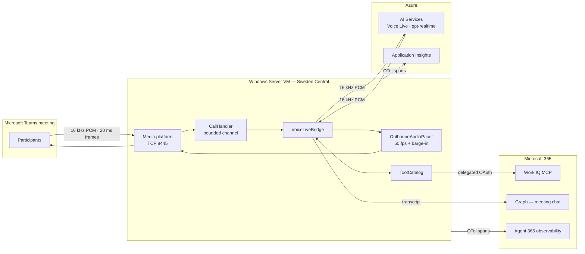

# Architecture — realtime voice agent in Microsoft Teams meetings

## What this is

A pro-code AI agent that joins a Microsoft Teams meeting as a participant, holds a spoken
conversation in real time, retrieves real organisational data through Work IQ, and posts a
written record into the meeting chat.

This deliberately takes the raw-media route that Microsoft Learn steers AI agents away from.
That guidance exists because real-time media bots are Windows-only, IP-affine and operationally
heavy — all of which is true and all of which is accepted here. What it buys is the thing no
supported path currently offers: **sub-second spoken interaction inside a live meeting**, rather
than post-hoc transcript analysis.

---

## Decision record

### 1. Teams audio: application-hosted media bot

The only way to get PCM frames out of a live meeting and push PCM back in.

| Constraint | Consequence |
| --- | --- |
| `Microsoft.Graph.Communications.Calls.Media` is .NET + Windows + x64 only | Windows Server host, `PlatformTarget=x64` |
| Cannot run on Azure App Service | IaaS VM (VMSS / Service Fabric / AKS also allowed) |
| Needs an instance-level public IP and a per-instance media port | One static public IP per instance, TCP 8445 |
| Needs a public-CA certificate whose subject matches the advertised FQDN | Let's Encrypt over HTTP-01 against the `cloudapp.azure.com` name |
| A call is pinned to the machine that created it | The notification URL carries the instance ordinal |
| SDK versions older than ~3 months stop working | Pinned to `1.2.0.17950` / `1.33.0.258-preview`, must be refreshed |

### 2. Realtime voice: Azure AI Voice Live, not the raw Azure OpenAI Realtime API

Both front the same `gpt-realtime` family. Voice Live wins on three specifics that matter here
and nowhere else:

| Problem | Azure OpenAI Realtime | Azure AI Voice Live |
| --- | --- | --- |
| Teams speaks 16 kHz PCM16 | `audio/pcm` is pinned to 24 kHz — resample both ways | `InputAudioSamplingRate = 16000`, `OutputAudioFormat = Pcm1616000hz`. **No resampling at all.** |
| The bot hears its own voice in the meeting mix | Solve it yourself, or self-interrupt forever | `server_echo_cancellation` |
| Conference-room noise | `near_field` / `far_field` | `azure_deep_noise_suppression` |
| Managed identity in .NET | Officially unsupported; needs a token-as-API-key hack | `new VoiceLiveClient(uri, credential)` |

Removing the resampler removes a whole class of quality bugs: imaging and aliasing artefacts
from a naive 16↔24 kHz conversion land squarely in the speech band and measurably degrade both
voice-activity detection and transcription.

Verified on the deployed resource: 2.51 s of audio returned as 80,400 bytes — exactly
16 kHz × 2 bytes × mono — with 1,036 ms to first audio.

### 3. Tools: local MCP dispatch, not Voice Live's server-side MCP

Voice Live can call remote MCP servers itself. It is not used that way here, because a
service-side tool call produces no span in this process — and Agent 365 observability, plus the
Purview and Defender signal derived from it, is built on those spans. Tool calls are therefore
dispatched locally: `response.function_call_arguments.done` → MCP `tools/call` → `function_call_output`.

### 4. Response gating

`CreateResponse = false` on the VAD. The model segments and transcribes continuously but only
answers when addressed by name. An always-on responder in a multi-party meeting talks over
everyone, which is the single fastest way to make a meeting agent unusable.

---

## Runtime shape

### The audio path in detail

**Inbound** — `AudioMediaReceived` fires 50×/second and the platform serialises the events, so
the handler does the minimum possible: `Marshal.Copy` out of unmanaged memory, drop the frame
into a bounded channel, and dispose the buffer in a `finally`. Everything else happens on a
separate pump. The channel is bounded with `DropOldest` so a stalled model connection sheds
stale audio instead of growing without limit.

**Outbound** — the model produces audio far faster than real time, so it cannot be handed
straight to the socket. `OutboundAudioPacer` owns the playback clock and emits exactly one
640-byte frame every 20 ms. Lookahead is capped at three frames: anything already handed to the
platform still plays after a flush, so lookahead converts directly into barge-in lag.

**Barge-in** — on `input_audio_buffer.speech_started`:

1. Flush the queue and append a one-frame linear ramp to silence, so the cut does not click.
2. `CancelResponseAsync` to stop the model generating.
3. `TruncateConversationAsync(itemId, 0, playedDuration)`.

Step 3 is the one that is easy to skip and expensive to omit. Without it the model believes it
said everything it generated — including the several seconds the meeting never heard — and will
refer back to it. The pacer is the only component that knows the true played duration, which is
why it owns that number.

---

## Identity and permissions

| Purpose | Identity | Grant |
| --- | --- | --- |
| Join meetings, access media | App registration, app-only | `Calls.JoinGroupCall.All`, `Calls.AccessMedia.All`, `Calls.JoinGroupCallAsGuest.All`, `OnlineMeetings.Read.All` — admin consented |
| Voice Live | User-assigned managed identity | `Cognitive Services User` on the AI Services resource |
| Work IQ MCP | **Delegated**, service account | `api://workiq.svc.cloud.microsoft/WorkIQAgent.Ask` |
| Meeting chat | App registration + RSC | `ChatMessage.Send.Chat` via the Teams app package |

### Why Work IQ needs a human in the loop, once

Work IQ does not support application-only authentication. That is a deliberate design choice,
not a gap: every call runs as a signed-in user so Microsoft 365 permissions are enforced and the
agent can never read data that user cannot.

A meeting bot has no interactive user. The resolution is a nominated service account that
consents once through `scripts/Connect-WorkIq.ps1` (device code flow). The refresh token is
stored on the media host, DPAPI-encrypted with the machine key, and exchanged for access tokens
at runtime; each rotated refresh token is written back.

**This means the agent sees exactly what that service account can see.** Choose it deliberately
and scope it as tightly as the scenario allows.

### A note on secret storage

The template provisions a Key Vault, but this tenant enforces `publicNetworkAccess: Disabled`
on vaults and re-applies it within seconds of any change. Rather than fight the guardrail, the
delegated refresh token is held in a DPAPI-encrypted file under `C:\rtbot\state`, ACL'd to
SYSTEM / Administrators / NETWORK SERVICE. The ciphertext is bound to the machine, so a copied
file is useless.

The production hardening is a **private endpoint for the vault into the bot's subnet**, at which
point `KeyVaultTokenStore` takes over with no code change — set `RtBot:KeyVaultUri`.

---

## Reference deployment

| Resource | Value |
| --- | --- |
| Region | Sweden Central — UK South has no realtime models |
| Host | Windows Server VM with a public FQDN and a Let's Encrypt certificate |
| AI Services | One Foundry / AI Services resource hosting Voice Live and the text model |
| Realtime model | `gpt-realtime-2.1` (service-managed in Voice Live) |

---

## Known limits

- **Session length.** Voice Live sessions cap out around 60 minutes. Longer meetings need a
  rolling reconnect: open the new socket, replay a condensed history, cut the audio pump over.
  Not yet implemented.
- **Single instance.** One VM, one public IP. Scaling means one public IP and media port per
  instance plus ordinal-aware notification routing — the architecture allows for it
  (`Media:InstanceOrdinal`) but it is not deployed.
- **Certificate renewal.** win-acme installs a renewal task, but the bot reads the thumbprint
  from configuration at start-up, so a renewal that changes the thumbprint needs a service
  restart.
- **Speaker attribution.** Mixed audio is used by default. `Media:ReceiveUnmixedAudio` gives
  per-speaker streams, but only when the bot joins as a bot — setting a display name makes it a
  guest and forfeits them.
- **Model versions.** Voice Live tracks the realtime family slightly behind Azure OpenAI;
  `gpt-realtime-2.1` has better silence handling but is not yet confirmed on Voice Live.

## Compliance

The bot streams meeting audio to an Azure AI Services resource and can write a transcript into
the meeting chat. Recording and transcribing a meeting carries consent obligations in the UK and
EU. Announce the agent's presence, and confirm the region and data-residency posture before
using this outside a proof of value.
